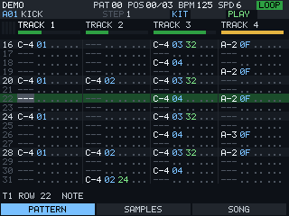
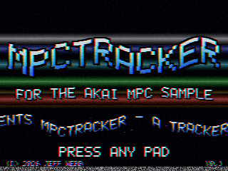
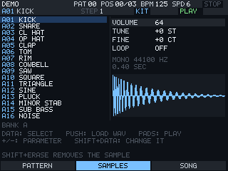
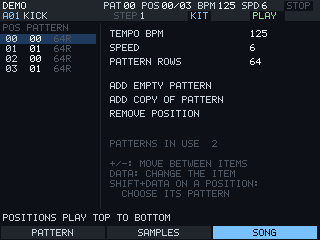

# MPCTRACKER

A pattern tracker for the Akai MPC Sample, run from an SD card.

  
  

MPCTRACKER turns the MPC Sample into a tracker in the spirit of ProTracker and Impulse Tracker.
Songs are written as rows of notes on eight tracks. The 16 pads play the samples, step through
the pattern, or act as a keyboard, and the DATA knob does the navigating. Samples come from WAV
files on the card, and ProTracker `.mod` files open and play the way ProTracker plays them.

The card's autorun script stops the sampler application, runs the tracker from RAM, and starts
the sampler again when you quit. Nothing is written to the device's own storage. Take the card
out and power cycle and the sampler is exactly as it was.

It was developed against the [virtual-mpc-sample](https://github.com/orrpunk-art/virtual-mpc-sample)
emulator on firmware 1.3.0.12. It starts and plays sound on a real unit. The rest of the testing
on hardware is still to be done, so expect rough edges.

## Contents

- [Safety](#safety)
- [Installing](#installing)
- [A first song](#a-first-song)
- [Controls](#controls)
- [Effects](#effects)
- [Files and formats](#files-and-formats)
- [Building](#building)
- [How it works](#how-it-works)
- [Not done yet](#not-done-yet)
- [Credits](#credits)

## Safety

This is an unofficial modification. It never writes to the sampler's internal storage and it
only writes inside the `tracker` folder on the card, but nobody has published a verified way to
recover an MPC Sample that fails to boot, so you use it at your own risk.

Save the project that is open on the sampler before you insert the card. Starting the tracker
shuts the sampler application down the same way a normal shutdown does, and that application
keeps its temporary project, but unsaved work should never depend on that.

Use a spare card if you can, or copy your card to a computer first. Copying the `autorun` folder
onto a card replaces any `autorun` folder that is already there, so keep a copy of one you want
to keep.

## Installing

Download `mpctracker-v0.1.0-sd-card.zip` from the
[latest release](https://github.com/jeffwebb-to/mpc-sample-tracker/releases/latest), or build the
package yourself as described under [Building](#building). Either way you end up with the same
`autorun` and `tracker` folders.

1. Unzip it and copy the `autorun` and `tracker` folders to the root of the SD card.
2. Put your own WAV files in `tracker/samples`. Any folder on the card can be browsed, so
   samples that are already on the card work as well.
3. Insert the card. The tracker starts a few seconds after the sampler has booted, and again at
   every power-on while the card is in.
4. Hold SHIFT and press STOP to quit back to the sampler.

On a first run it plays a built-in drum kit and a short groove. If there is a `.mod` file in
`tracker/songs` it opens the first one instead. After that it picks up where you left off.

## A first song

The screen has three pages. SCREEN 1 is the pattern, SCREEN 2 the samples and SCREEN 3 the song
order. Hold SHIFT and the same three buttons become SAVE, LOAD and NEW.

  
  

Press SEQ RECORD to switch between play mode and write mode. In play mode the pads only make
sound. In write mode they also put notes into the pattern at the cursor, and the cursor moves
down by the edit step after each one. If the song is playing, notes land on the row under the
playhead instead, rounded to the nearest row. Hit a pad softly and the note gets a volume.

The pads have three modes. By default each pad is one sample from the current bank. 16 LEVELS
turns the 16 pads into a chromatic keyboard for the current sample, and PAD BANK changes the
octave. NOTE REPEAT turns them into the 16 rows on screen, so a pad toggles a note on that row
for the track under the cursor.

When the cursor is in the sample, volume, effect or effect value column, the pads become a
value picker. In the effect column the 16 pads are the 16 effects, 0 to F, and the pad for the
current value is lit.

Hold MUTE and press pad 1 to 8 to mute a track. CHOP is undo, and SHIFT with CHOP is redo.
There are 20 levels.

## Controls

### Everywhere

| Control | Action |
|---|---|
| PLAY | Play the pattern from the top. With SHIFT, from the cursor row |
| STOP | Stop. Press again to go back to row 0. With SHIFT, quit to the sampler |
| LOOP | Switch between looping the pattern and playing through the song |
| SEQ RECORD | Switch between play mode and write mode |
| PAD BANK | Next sample bank, A to D. With SHIFT, the previous one. In 16 LEVELS, the octave |
| 16 LEVELS | Pads play the current sample as a keyboard |
| NOTE REPEAT | Pads are the 16 rows on screen |
| MUTE and a pad | Mute or unmute that track, tracks 1 to 8 |
| TAP TEMPO | Tap the tempo. Hold it and turn DATA to set the BPM exactly |
| CHOP | Undo. With SHIFT, redo |
| SAMPLE SELECT | Open the sample browser for the current slot |
| MAIN VOLUME | Master volume |
| K2 | Edit step, how many rows the cursor moves after each entry, 0 to 8 |

### Pattern page

Each track has five columns, which are note, sample, volume, effect and effect value. Four
tracks show at a time and the view follows the cursor.

| Control | Action |
|---|---|
| DATA turn | Move up and down the rows |
| PLUS and MINUS | Next or previous column. With SHIFT, jump a whole track |
| SHIFT and DATA turn | Change the value under the cursor |
| DATA push | Lock value editing on so DATA changes values without SHIFT. Push again to release |
| SEQ held and DATA turn | Pick which pattern you are editing |
| ERASE | Clear what is under the cursor. With SHIFT, clear the whole track in this pattern |

### Samples page

DATA picks a slot and the pads play the bank. Push DATA to load a WAV into the slot. PLUS and
MINUS choose a setting, which is volume, tune, fine tune or loop, and SHIFT with DATA changes
it. SHIFT with ERASE empties the slot.

In the browser, DATA scrolls and a file plays as soon as you stop on it. Push DATA to load it
or to open a folder, MINUS goes up a folder and STOP closes the browser.

### Song page

The list on the left is the order the patterns play in. PLUS and MINUS move between the list,
the tempo, the speed, the pattern length and three actions, which add an empty pattern, add a
copy of the current one, or remove a position. DATA changes the selected item. On a position,
SHIFT with DATA chooses the pattern it plays.

## Effects

The effect column uses the numbering of a ProTracker module.

| Effect | Does | Effect | Does |
|---|---|---|---|
| 0xy | Arpeggio | 9xx | Sample offset |
| 1xx | Slide up | Axy | Volume slide |
| 2xx | Slide down | Bxx | Jump to song position |
| 3xx | Glide to the note | Cxx | Set volume |
| 4xy | Vibrato | Dxx | Pattern break |
| 5xy | Glide and volume slide | Fxx | Speed below 32, tempo from 32 |
| 6xy | Vibrato and volume slide | E1x, E2x | Fine slide up, down |
| 7xy | Tremolo | E6x | Loop rows |
| 8xx | Pan | E8x | Chance, the note plays x times in 16 |
| E9x | Retrigger every x ticks | EAx, EBx | Fine volume up, down |
| ECx | Cut the note at tick x | EDx | Delay the note to tick x |
| EEx | Pattern delay | | |

C-4 is the note at which a sample plays at its own speed.

## Files and formats

Songs are saved as `.mst` files in `tracker/songs` with their samples inside. SAVE writes
`SONG001.mst`, `SONG002.mst` and so on for a new song and keeps saving to the same file
after that. `AUTOSAVE.mst` is written every time you quit and loaded the next time you start.

WAV files can be 8, 16, 24 or 32 bit integer or 32 bit float, mono or stereo, up to 120
seconds. Loop points stored in the file are used. All the samples in a song together are
limited to 400 MB.

Modules with 4 to 8 channels open from the LOAD page. A module is played in ProTracker mode,
which follows the original player where it differs from other trackers. Slides stop at the
same limits, periods come from the same table, and `1xx`, `2xx` and `Axy` have no memory, so a
zero parameter does nothing. The mode is stored in the `.mst` file. Songs written in the
tracker itself play without it, so for them a zero parameter repeats the last value.

## Building

You need Docker and the `mpclab-tools` image, which `python3 lab.py build` creates in
[virtual-mpc-sample](https://github.com/orrpunk-art/virtual-mpc-sample).

    ./build.sh               # build/tracker and dist/tracker-autorun.zip
    ./lab-run.sh             # run it in the emulator
    ./lab-run.sh --stop

`lab-run.sh` expects the emulator checked out next to this repository, or set `LAB_DIR` to
wherever it is. Add `TRACKER_FLAGS=--no-intro` to skip the start-up screen.

To have a demo song on the card, put one `.mod` in `demo/` before you build. Files in there are
ignored by git, so only use music you have the right to copy.

The replayer also builds on a desktop, which is the quick way to check a change to it.

    python3 tools/selftest.py                # pitch, row timing, slide limits, effect memory
    cc -O2 -Isrc tools/render.c src/song.c src/player.c -lm -lpthread -o build/render
    ./build/render some.mod out.wav 60       # render a song to a WAV

## How it works

`src/hw.c` owns the three devices. The screen is a DRM dumb buffer and only the rows that
changed are sent, because the panel sits on SPI and every update is a transfer. The control
surface is a raw MIDI device, and audio goes to the ALSA PCM device from a real-time thread.

`src/player.c` is the replayer and mixer. It keeps pitch as an Amiga style period so the slide
effects behave as they do in a module. `src/song.c` has the song model, the file formats and
the built-in kit. `src/ui.c` has the screens and the pad and button handling. A pad hit starts
its sound on the input thread, so the delay does not depend on how long the screen takes to
draw. `src/intro.c` is the start-up screen, a short VHS tape with a waving title. Any pad skips it.

## Not done yet

Sampling from the inputs, block copy and paste, a fill tool, naming songs on the device, a view
of all eight tracks at once, and MIDI.

## Credits

Inspired by [mpc-sample-lab](https://github.com/gospodindilly-ops/mpc-sample-lab) and
[Polyend's Tracker](https://github.com/polyend/tracker-ce). No code from either is used.

This project is not affiliated with Akai Professional or inMusic. MPC and Akai Professional
belong to their owners.

## Licence

MIT. See [LICENSE](LICENSE).
